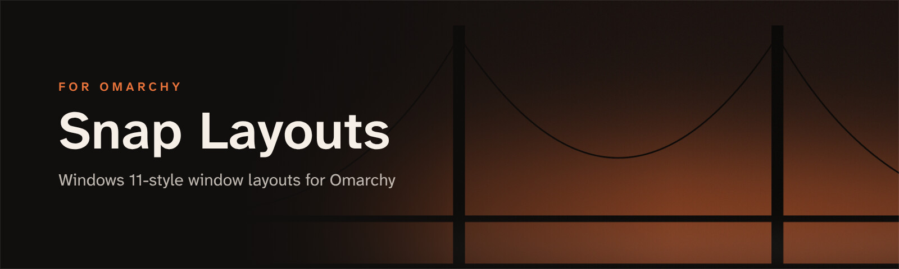
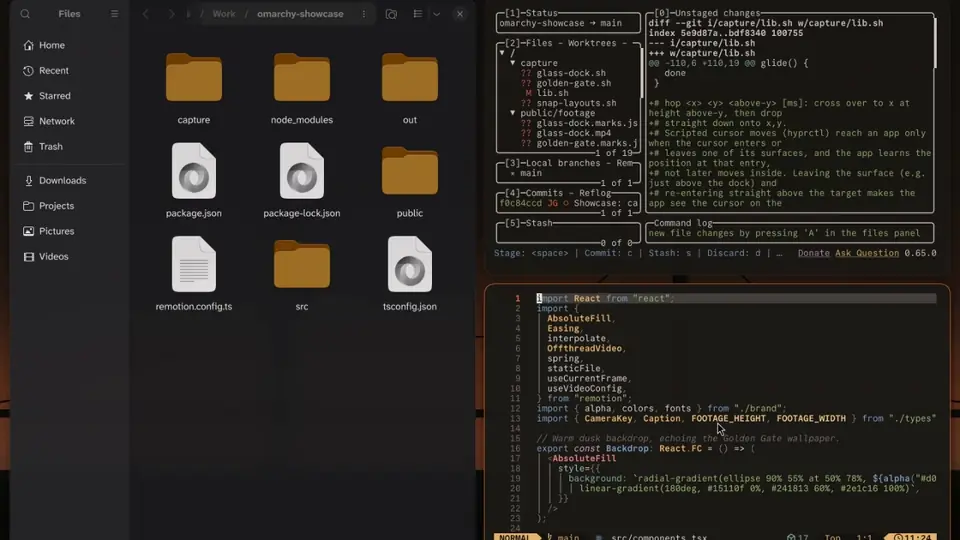

<p align="center">
  
</p>

<p align="center">
  <b>Windows 11-style window layouts for <a href="https://omarchy.org">Omarchy</a>.</b><br>
  Press a key · pick a layout · choose where your window goes
</p>

<p align="center">
  
  
  
</p>

<p align="center">
  
</p>

## Get started

**1. Install the plugin.** It loads only while the picker is open, so it uses no memory the rest of the time.

```bash
omarchy plugin add https://github.com/JeoCrypto/omarchy-snap-layouts --enable
```

**2. Give it a key** in `~/.config/hypr/bindings.lua` (`SUPER + Z` is the Windows 11 shortcut and is free in Omarchy's defaults):

```lua
o.bind("SUPER + Z", "Snap layouts", "omarchy-shell shell toggle io.github.jeocrypto.snap-layouts")
```

**3. Frost the glass** (recommended) in `~/.config/hypr/looknfeel.lua`:

```lua
hl.layer_rule({ match = { namespace = "^snap-layouts$" }, blur = true, ignore_alpha = 0.2 })
```

## Six layouts

| # | Layout | Zones |
|---|---|---|
| 1 | Halves | left, right |
| 2 | 60 / 40 | big left, right top, right bottom |
| 3 | 70 / 30 | wide left, narrow right |
| 4 | Three columns | left, centre, right |
| 5 | Center focus | left side, centre, right side |
| 6 | Grid | Omarchy's default tiling (dwindle) |

The layout applies to the active workspace only and survives a Hyprland reload.

## Keys

| Key | Action |
|---|---|
| `1`–`6` | Pick a layout (the highlight starts on its main zone) |
| `←` `↑` `↓` `→` | Move the highlight to the neighbouring zone |
| `Enter` / `Space` | Put the focused window in the highlighted zone |
| `Tab` / `Shift+Tab` | Next / previous layout |
| `Esc` | Close |

With the mouse, hover over a zone and click it.

You can also apply a layout from a script with `bin/snap-layout <halves|sixty|seventy|thirds|center|grid> [zone]`, where zones are numbered from 0, left to right and top to bottom.

## Language

Labels are in English by default. For Portuguese:

```bash
mkdir -p ~/.config/snap-layouts && echo pt > ~/.config/snap-layouts/language
```

## Update and remove

```bash
omarchy plugin update io.github.jeocrypto.snap-layouts
omarchy plugin remove io.github.jeocrypto.snap-layouts
```

After an update, run `omarchy restart shell` so the shell loads the new version.

## Run without the plugin system (optional)

```bash
git clone https://github.com/JeoCrypto/omarchy-snap-layouts
cd omarchy-snap-layouts
./install.sh
qs -c snap-layouts &
```

This also puts `snap-layout` in `~/.local/bin`. Bind `qs -c snap-layouts ipc call snap toggle` to a key, and start it at login with `o.launch_on_start("qs -c snap-layouts")` in `~/.config/hypr/autostart.lua`.

## How it works

Layouts 1–5 switch the workspace to Hyprland's master layout and set the master side (`orientation`) and width (`mfact`). The focused window becomes the master and is then swapped into the chosen zone. Grid switches back to dwindle.

Hyprland only centres the master once there are at least two other windows. So with exactly two windows, the centre zone sets `master:slave_count_for_center_master` to 0, and a side zone puts the window on that side at the side column's width.

The workspace's layout is saved in `~/.local/state/omarchy/workspace-layouts/`, the same place `omarchy-hyprland-workspace-layout-toggle` uses, so it survives a reload. Colours follow the active Omarchy theme.

## Requirements

- Omarchy 4 (Hyprland 0.55+ with Lua config, Quickshell 0.3+)
- `jq`, which Omarchy includes

---

<p align="center">
  <b>Part of the Golden Gate set for Omarchy</b><br>
  <a href="https://github.com/JeoCrypto/omarchy-golden-gate-theme">Golden Gate theme</a> ·
  <a href="https://github.com/JeoCrypto/omarchy-glass-dock">Glass Dock</a> ·
  <a href="https://github.com/JeoCrypto/omarchy-spotlight-apps">Spotlight Apps</a> ·
  <a href="https://github.com/JeoCrypto/omarchy-snap-layouts">Snap Layouts</a>
</p>

<p align="center"><sub>MIT licence</sub></p>
