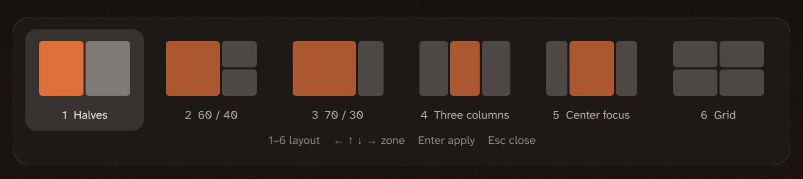

# Snap Layouts

A Windows 11-style layout picker for [Omarchy](https://omarchy.org) and Hyprland, built with [Quickshell](https://quickshell.org) (which Omarchy already ships). Press a key, pick a layout and choose where the focused window goes.



| # | Layout | Zones |
|---|---|---|
| 1 | Halves | left, right |
| 2 | 60 / 40 | big left, right top, right bottom |
| 3 | 70 / 30 | wide left, narrow right |
| 4 | Three columns | left, centre, right |
| 5 | Center focus | left side, centre, right side |
| 6 | Grid | Omarchy's default tiling (dwindle) |

The layout applies to the active workspace only and survives a Hyprland reload.

## Use

| Key | Action |
|---|---|
| `1`–`6` | Pick a layout (the highlight starts on its main zone) |
| `←` `↑` `↓` `→` | Move the highlight to the neighbouring zone |
| `Enter` / `Space` | Put the focused window in the highlighted zone |
| `Tab` / `Shift+Tab` | Next / previous layout |
| `Esc` | Close |

With the mouse, hover over a zone and click it.

You can also apply a layout from a script: `snap-layout <halves|sixty|seventy|thirds|center|grid> [zone]`, where zones are numbered from 0, left to right and top to bottom.

## Install

```bash
git clone https://github.com/JeoCrypto/omarchy-snap-layouts
cd omarchy-snap-layouts
./install.sh
qs -c snap-layouts &
```

### Keybinding

Add to `~/.config/hypr/bindings.lua` (`SUPER + Z` is the Windows 11 shortcut and is free in Omarchy's defaults):

```lua
o.bind("SUPER + Z", "Snap layouts", "qs -c snap-layouts ipc call snap toggle")
```

### Start at login

Add to `~/.config/hypr/autostart.lua`:

```lua
o.launch_on_start("qs -c snap-layouts")
```

### Frosted blur (recommended)

Add to `~/.config/hypr/looknfeel.lua`:

```lua
hl.layer_rule({ match = { namespace = "^snap-layouts$" }, blur = true, ignore_alpha = 0.2 })
```

### Language

Labels are in English by default. For Portuguese:

```bash
mkdir -p ~/.config/snap-layouts && echo pt > ~/.config/snap-layouts/language
```

## How it works

Layouts 1–5 switch the workspace to Hyprland's master layout and set the master side (`orientation`) and width (`mfact`). The focused window becomes the master and is then swapped into the chosen zone. Grid switches back to dwindle. The workspace's layout is saved in `~/.local/state/omarchy/workspace-layouts/`, the same place `omarchy-hyprland-workspace-layout-toggle` uses, so it survives a reload. Colours follow the active Omarchy theme.

## Requirements

- Omarchy 4 (Hyprland 0.55+ with Lua config, Quickshell 0.3+)
- `jq`, which Omarchy includes

## License

MIT
